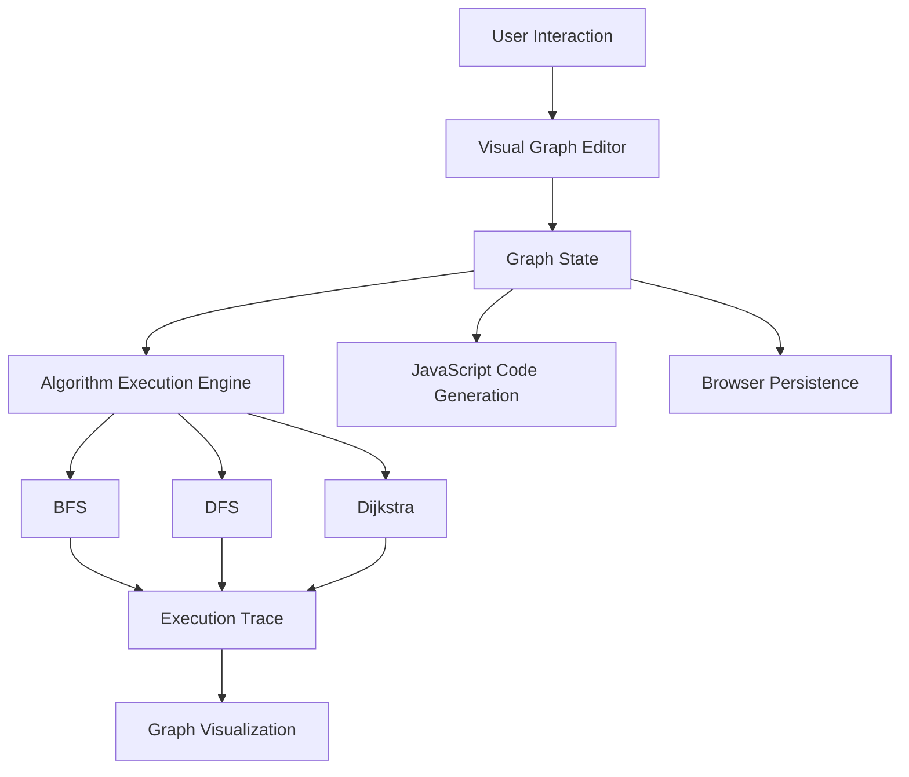

 
<div align="center">


### アルゴリズムに、形を与える。

*Give logic a form.*

**An experimental visual algorithm engineering studio.**

Connect nodes. Construct graphs. Execute algorithms. Explore solutions.

<br>


<br>

`LOGIC` · `GRAPHS` · `ALGORITHMS` · `COMPUTATION` · `VISUALIZATION`

---

</div>

## 00 — SYSTEM IDENTITY

```text
╔════════════════════════════════════════════════════════════════╗
║                                                                ║
║     █████╗ ██████╗ ██╗  ██╗ ██████╗                           ║
║    ██╔══██╗██╔══██╗██║ ██╔╝██╔═══██╗                          ║
║    ███████║██████╔╝█████╔╝ ██║   ██║                          ║
║    ██╔══██║██╔══██╗██╔═██╗ ██║   ██║                          ║
║    ██║  ██║██║  ██║██║  ██╗╚██████╔╝                          ║
║    ╚═╝  ╚═╝╚═╝  ╚═╝╚═╝  ╚═╝ ╚═════╝                           ║
║                                                                ║
║    ALGORITHM RESEARCH & KNOWLEDGE OPTIMIZER                    ║
║                                                                ║
║    ENGINE      : Visual Graph Computing                        ║
║    INTERFACE   : Interactive Node Workspace                    ║
║    EXECUTION   : Graph Traversal & Pathfinding                 ║
║    BUILD       : v0.1.0-alpha                                  ║
║    STATE       : EXPERIMENTAL                                  ║
║                                                                ║
╚════════════════════════════════════════════════════════════════╝
```

**ARKO** is an experimental algorithm engineering environment designed to transform abstract computational logic into interactive, visual structures.

It explores the intersection of graph theory, algorithm design, interactive visualization, and computational reasoning.

Instead of treating algorithms as static blocks of code, ARKO provides a workspace where relationships can be constructed, inspected, modified, and executed.

The long-term objective is to develop a visual algorithm construction engine capable of interpreting connected logic nodes, validating execution paths, generating code, and evaluating candidate solutions.

> Not another algorithm cheat sheet. An environment for engineering algorithms.

---

## 01 — THE CORE PHILOSOPHY

```text
                  THE ARKO COMPUTATION MODEL

                           [ PROBLEM ]
                               │
                               ▼
                         [ GRAPH MODEL ]
                               │
                  ┌────────────┴────────────┐
                  ▼                         ▼
             [ NODES ]                  [ EDGES ]
                  │                         │
                  └────────────┬────────────┘
                               ▼
                       [ ALGORITHM ENGINE ]
                               │
                    ┌──────────┼──────────┐
                    ▼          ▼          ▼
                 [ BFS ]    [ DFS ]   [ DIJKSTRA ]
                    │          │          │
                    └──────────┼──────────┘
                               ▼
                       [ EXECUTION TRACE ]
                               │
                               ▼
                        [ VISUAL OUTPUT ]
```

ARKO follows a simple engineering principle:

**An algorithm should not only produce an answer. Its execution should be understandable.**

The system is intended to evolve through three major pillars.

| Pillar | Purpose | State |
|:---|:---|:---|
| **ARKO Graph** | Construct and explore computational graphs | Alpha |
| **ARKO Flow** | Design algorithms using executable logic nodes | Planned |
| **ARKO Solve** | Analyze problems and generate candidate solutions | Research direction |

---

## 02 — CURRENT CAPABILITIES

### `01` Interactive Graph Workspace

A visual environment for constructing connected graphs.

- Create and position nodes.
- Establish connections between nodes.
- Modify edge weights.
- Explore graph structures visually.
- Manipulate graph topology through an interactive interface.

### `02` Algorithm Execution Engine

The initial prototype focuses on fundamental graph algorithms.

| Algorithm | Purpose |
|:---|:---|
| **Breadth-First Search** | Layer-by-layer graph traversal |
| **Depth-First Search** | Depth-oriented graph exploration |
| **Dijkstra's Algorithm** | Shortest paths on nonnegative weighted graphs |

### `03` Execution Visualization

Rather than returning only the final result, ARKO provides tools for examining algorithm execution.

- Step-by-step traversal.
- Visual exploration of nodes and connections.
- Inspection of execution progress.
- Interactive graph experimentation.

### `04` Code Generation

ARKO includes initial JavaScript code-generation capabilities for graph-based algorithms.

This is an early feature and does not yet represent a general-purpose visual programming compiler.

### `05` Local-First Experimentation

The current version operates directly in the browser.

No database server, authentication provider, or external API key is required.

---

## 03 — SYSTEM ARCHITECTURE



### Architectural Direction

ARKO is being developed around the separation of four concerns:

**Graph Model** — Maintains nodes, edges, weights, and graph relationships.

**Execution Engine** — Runs supported algorithms against validated graph inputs.

**Visualization Layer** — Translates computational states into visible execution steps.

**Code Generation** — Produces source code representations of supported graph operations.

Future versions will introduce an intermediate representation for visual algorithms, allowing the interface and execution engine to evolve independently.

---

## 04 — TECHNICAL FOUNDATION

| Layer | Technology |
|:---|:---|
| Interface | HTML5 |
| Styling | CSS3 |
| Application Logic | JavaScript ES6+ |
| Visualization | Browser-native rendering |
| Persistence | Browser storage |
| Algorithm Engine | JavaScript |
| Runtime | Modern web browser |

### Why No Framework?

The initial version prioritizes understanding the computational foundations over adding unnecessary infrastructure.

ARKO begins as a lightweight, dependency-free prototype.

The architecture may evolve toward TypeScript, a modular execution engine, and more advanced graph-rendering libraries as the project grows.

---

## 05 — QUICK START

**Clone the repository.**

```bash
git clone https://github.com/azinamouto/arko.git
```

**Enter the project directory.**

```bash
cd arko
```

**Launch ARKO.**

Open `index.html` in your browser.

Alternatively, serve the directory using Python:

```bash
python -m http.server 8000
```

Then navigate to:

```text
http://localhost:8000
```

No package installation is required for the initial prototype.

---

## 06 — PROJECT STRUCTURE

```text
arko/
│
├── index.html          # Interactive algorithm studio
├── README.md           # Project documentation
└── .gitignore          # Git exclusions
```

The current project uses a minimal structure for rapid experimentation.

A modular architecture is planned as the execution engine becomes more complex.

---

## 07 — DEVELOPMENT ROADMAP

<details>
<summary><b>v0.1 — GRAPH FOUNDATION</b></summary>

<br>

- [x] Initial interactive graph editor
- [x] Node positioning and connections
- [x] Weighted graph representation
- [x] BFS traversal
- [x] DFS traversal
- [x] Dijkstra's algorithm
- [x] Execution visualization
- [x] Initial JavaScript code generation
- [x] Browser-based persistence

</details>

<details>
<summary><b>v0.2 — VISUAL LOGIC ENGINE</b></summary>

<br>

- [ ] Typed input/output ports
- [ ] Logical operation nodes
- [ ] Conditional branching
- [ ] Loop constructs
- [ ] Graph validation
- [ ] Executable visual workflows
- [ ] Intermediate representation
- [ ] Runtime error inspection

</details>

<details>
<summary><b>v0.3 — ALGORITHM LABORATORY</b></summary>

<br>

- [ ] A* pathfinding
- [ ] Bellman–Ford
- [ ] Topological sorting
- [ ] Minimum spanning trees
- [ ] Algorithm comparison mode
- [ ] Execution benchmarks
- [ ] Complexity annotations
- [ ] Memory usage analysis

</details>

<details>
<summary><b>v0.4 — SOLUTION ENGINE</b></summary>

<br>

- [ ] Structured problem definitions
- [ ] Input constraint analysis
- [ ] Algorithm recommendation engine
- [ ] Candidate solution generation
- [ ] Test-case generation
- [ ] Correctness verification for supported cases
- [ ] Python and JavaScript export
- [ ] Algorithm execution sandbox

</details>

<details>
<summary><b>v1.0 — ENGINEERING WORKSPACE</b></summary>

<br>

- [ ] Modular visual programming engine
- [ ] Graph and logic workflow integration
- [ ] Reusable algorithm components
- [ ] Workflow import and export
- [ ] Execution debugger
- [ ] Automated test runner
- [ ] Documented extension interfaces
- [ ] Stable project format

</details>

---

## 08 — ENGINEERING CHALLENGES

The project is also intended as a practical environment for studying computer science fundamentals.

```text
[ GRAPH THEORY ]
       ├── Traversal
       ├── Connectivity
       ├── Shortest Paths
       └── Graph Representation

[ ALGORITHM DESIGN ]
       ├── Correctness
       ├── Complexity
       ├── Data Structures
       └── Optimization

[ EXECUTION SYSTEMS ]
       ├── Graph Validation
       ├── Runtime State
       ├── Execution Tracing
       └── Error Handling

[ FUTURE RESEARCH ]
       ├── Program Synthesis
       ├── Constraint Solving
       ├── Code Generation
       └── Algorithm Selection
```

ARKO is a learning-driven engineering project. Its purpose is to investigate these concepts through implementation, experimentation, testing, and iteration.

---

## 09 — LIMITATIONS

ARKO is currently an alpha-stage prototype.

The existing implementation focuses on graph editing and selected graph algorithms. It does not yet provide a general-purpose algorithm synthesizer, formally verified solutions, or a production-grade execution sandbox.

Features in the roadmap are development targets, not current capabilities.

Results should be independently validated before using generated algorithms in critical applications.

---

## 10 — CREATOR

<div align="center">

**AZINAMOUTO**

*Building systems. Studying complexity. Engineering logic.*

[](https://github.com/azinamouto)

<br>

```
   > initializing thought process...
   > loading graph structures...
   > resolving connections...
   > executing logic...

   [ ARKO SYSTEM ONLINE ]

   "Every solution begins with a structure."
```

---

### 論理を繋ぎ、可能性を創る。

*Connect logic. Create possibilities. Still work on progress*


<sub>ARKO © 2026 · Experimental Algorithm Engineering Project</sub>

</div>
